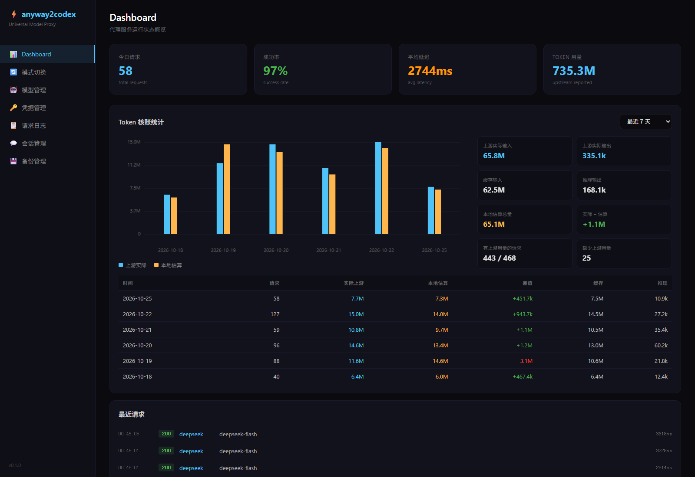
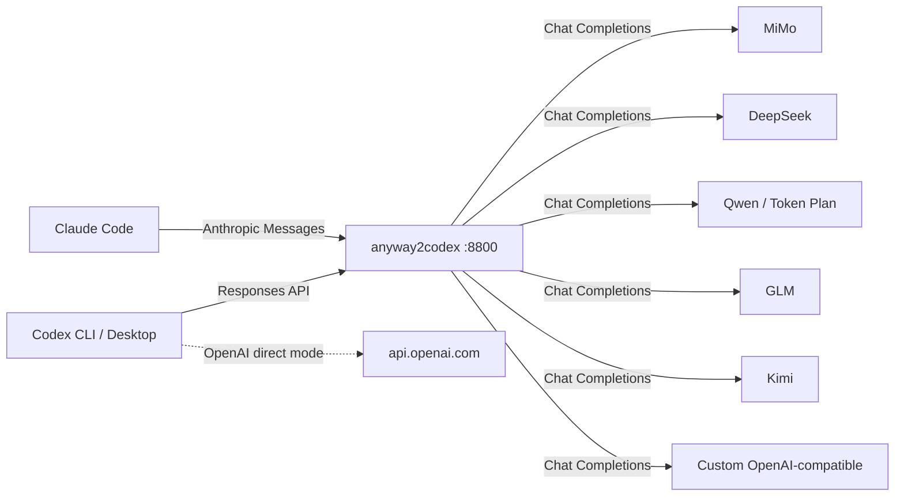

# anyway2codex

<p align="center">
  <strong>让 Codex 用上任意模型，同时保留官方 ChatGPT 登录。</strong><br>
  A local proxy that translates the OpenAI Responses API to Chat Completions — with multi-provider routing, fallback, vision fallback, and a built-in admin panel.
</p>

<p align="center">
  
  
  
  
</p>

<p align="center">
  <a href="#english">English</a> ·
  <a href="#快速开始">快速开始</a> ·
  <a href="#功能">功能</a> ·
  <a href="#模型支持">模型支持</a> ·
  <a href="#工作原理">工作原理</a> ·
  <a href="#faq">FAQ</a>
</p>

<p align="center">
  <a href="docs/admin-panel.png"></a>
</p>

> 面板默认地址：<http://127.0.0.1:8788/admin>（本文示例使用 8800）

---

## English

**anyway2codex** is a local proxy for OpenAI Codex (CLI / Desktop). It speaks the **Responses API** to Codex and **Chat Completions** to MiMo, DeepSeek, Qwen, GLM, Kimi, and any custom OpenAI-compatible endpoint.

- Streaming SSE translation, tool calls, reasoning content, and image handling.
- Anthropic Messages (`/v1/messages`) support for Claude Code clients.
- Primary model + automatic fallback; per-request vision fallback.
- Encrypted API-key history, token accounting, conversation-grouped logs, and config backups.
- Switching back to official OpenAI only edits `config.toml`; `auth.json` / ChatGPT OAuth is never overwritten.

---

## 为什么需要它

Codex 只说 Responses API，而绝大多数国内模型只说 Chat Completions。直接改 `config.toml` 能连上，但模型名、端点、思考参数、图片能力、上下文长度、fallback 和计费统计都要自己维护。

| 直接改 Codex 配置 | anyway2codex |
|---|---|
| 每家厂商的模型名、端点、思考参数都要自己试 | 内置适配层，按厂商处理参数差异 |
| 换模型要改配置、重启 Codex | 面板切换主模型 / fallback，代理即时生效 |
| 不支持图片的模型只能丢图 | 自动回退到多模态模型，下一轮切回原模型 |
| 切回官方 GPT 容易把登录弄丢 | 只改 `config.toml`，保留 ChatGPT OAuth |
| 不知道每次请求花了多少 token | 按对话、模型、时间统计上游实际用量 |
| 上游失败只能重开对话 | 首包前自动切换备用模型，并记录原因 |

## 功能

- **协议翻译**：Responses API ⇄ Chat Completions，覆盖流式 SSE、工具调用、`reasoning_content`、图片输入和工具返回图片。
- **多协议入口**：除 Codex 的 `/v1/responses` 外，也提供 `/v1/chat/completions` 和 Anthropic 的 `/v1/messages`。
- **Provider 适配**：内置 MiMo、DeepSeek、通义千问、智谱 GLM、Kimi，并支持任意 OpenAI 兼容端点。
- **主模型 + fallback**：上游首包前失败自动切换备用模型；流已开始则明确报流错误，不伪造成功响应。
- **代理控制模型**：Codex 的 `model` 只是占位符，实际主模型和 fallback 由面板决定，切换不需要改 Codex 配置。
- **视觉回退**：按模型标注 `supportsImages`；不支持图片的模型会临时路由到多模态模型，图片不会被静默丢弃。
- **凭据历史**：Key 在 SQLite 内以 AES-256-GCM 加密；历史 Base URL / Key 可查、可一键回切。
- **观测与对账**：按对话归组的请求日志、完整推理与工具调用过程、上游实际 token 与本地估算对比。
- **安全切换**：写入 Codex 配置前自动备份，面板可一键恢复。
- **保活与恢复**：SSE 心跳、上游超时与中断处理、进程崩溃日志、分离启动脚本。

## 界面预览

管理面板包含：

| 页面 | 作用 |
|---|---|
| Dashboard | 请求量、成功率、平均延迟、token 用量与逐日对账 |
| 模式切换 | 国内模型 / OpenAI 直连、代理主模型、fallback、OAuth 状态 |
| 模型管理 | 当前 provider 的模型清单、视觉能力、上下文窗口 |
| 凭据管理 | 保存 / 查看 / 切换历史 Base URL 与 Key |
| 请求日志 | 按对话、provider、模型、状态筛选 |
| 会话管理 | 按 Codex 对话归组的完整过程 |
| 备份管理 | 查看与恢复 Codex 配置备份 |

## 快速开始

### 环境要求

- Node.js **>= 18**
- Windows / macOS / Linux
- Codex CLI 或 Codex Desktop

### 安装与启动

```bash
git clone https://github.com/begin2019510/anyway2codex.git
cd anyway2codex
npm install
npm run build
node dist/cli.js --port 8800
```

打开 <http://127.0.0.1:8800/admin>。

> `npm install` 会安装固定版本 `mimo2codex@0.5.29`，`postbuild.cjs` 从中复制并修补协议翻译层。也可以用 `MIMO2CODEX_DIST` 指向自定义 sidecar 目录。

### Windows 一键重启

编辑 `scripts/reload-proxy.vbs` 里的项目路径，然后双击：

1. 先构建；构建失败就退出，**不会碰正在运行的代理**。
2. 只停止监听目标端口的进程。
3. 以分离进程启动，Codex 关闭后代理仍然在线。
4. 轮询 `/health` 并弹窗汇报结果。

### 接入 Codex

1. 打开面板 → **凭据管理**，填入对应厂商的 API Key。
2. 打开 **模式切换**，选择主模型，点 **切换到国产模型**。
3. 重启 Codex 或新建会话。

代理会写入类似下面的配置：

```toml
model = "anyway2codex-auto"
model_provider = "anyway2codex-proxy"

[model_providers.anyway2codex-proxy]
name = "anyway2codex (local proxy)"
base_url = "http://127.0.0.1:8800/v1"
wire_api = "responses"
requires_openai_auth = true
request_max_retries = 1
```

之后切换主模型 / fallback 只需要在面板操作，Codex 的 `model` 不需要再改。

### 切回官方 OpenAI

面板 → **模式切换** → **切换到 OpenAI 直连**。

- 只改 `config.toml`，把 `model_provider` 设为内置的 `openai`。
- **完全不写 `auth.json`**，现有 ChatGPT OAuth 登录原样保留。
- 请求不再经过代理，直接访问 `api.openai.com`。
- 切换前会检查 OAuth 是否完整；缺少 token 时提示先登录，不破坏现有认证状态。

## 模型支持

面板会读取 provider 注册表并实时展示模型、视觉能力和上下文窗口。下表是当前内置的常用模型，**模型 ID 与能力以面板为准**。

| Provider | Base URL | 常用模型 | 备注 |
|---|---|---|---|
| MiMo（小米） | `https://token-plan-cn.xiaomimimo.com/v1` | `mimo-v2.6-pro`、`mimo-v2.6-pro-ultraspeed`、`mimo-v2.6-flash` | Flash 支持视觉；Pro 系列为纯文本 |
| DeepSeek | `https://api.deepseek.com` | `deepseek-v4-pro`、`deepseek-v4-pro-0813`、`deepseek-flash` | `deepseek-flash` 支持视觉 |
| 通义千问 | `https://maas.qianwenaiapi.com/compatible-mode/v1` | `qwen3.8-max`、`qwen3.8-flash`、`qwen3.7-max`、`qwen3.7-plus` | 同端点还托管 GLM / DeepSeek / Kimi / MiniMax，详见 [docs/qwen-models.md](docs/qwen-models.md) |
| 智谱 GLM | `https://open.bigmodel.cn/api/paas/v4` | `glm-5.3`、`glm-5.2`、`glm-5.3-flash`、`glm-ocr` | `glm-5.3` 仅思考模式，传 `enable_thinking=false` 会 400 |
| Kimi（Moonshot） | `https://api.moonshot.cn/v1` | `kimi-k3`、`kimi-k2.7-code`、`kimi-k2.6` | 上下文与思考参数按模型区分 |
| 通用 Provider | 自定义 | 任意 OpenAI 兼容模型 | 通过 `providers.json` 或环境变量配置 |

### 图片与多模态

- 注册表为每个模型标注 `supportsImages`，面板的模型管理页可以直接看到。
- 选中的模型不支持图片时，代理会按 **视觉回退** 配置临时路由到多模态模型；处理完这一轮后，下一轮自动回到原模型。
- 工具调用返回的图片同样会保留：代理会把图片作为一条合成的多模态 user 消息追加在工具结果之后，而不是要求模型 OCR 或直接丢弃。
- 视觉回退可以在面板关闭；关闭后，不支持图片的模型会记录一条丢弃告警。

### 千问模型清单

千问网关同时托管 Qwen、GLM、DeepSeek、Kimi、MiniMax，且每个模型族的思考参数名和档位不同。完整清单、计费模式、`reasoning_effort` 档位和 400 规避规则见：

- [docs/qwen-models.md](docs/qwen-models.md)

## 工作原理



一次请求的路径：

```text
Responses request
  → 选择 provider（固定主模型 / 按 model 字段 / fallback）
  → provider.preprocessResponses
  → reqToChat：Responses → Chat Completions
  → 上游 Chat Completions（流式或非流式）
  → streamToSse / respToResponses：转回 Responses
  → Codex 收到标准 Responses SSE
```

代理只监听本机回环地址，不对外暴露。OpenAI 直连模式请求不经过代理。

### HTTP 接口

| 方法 | 路径 | 用途 |
|---|---|---|
| POST | `/v1/responses` | Codex Responses API |
| POST | `/v1/chat/completions` | OpenAI Chat Completions 兼容入口 |
| POST | `/v1/messages` | Anthropic Messages（Claude Code） |
| POST | `/v1/messages/count_tokens` | Claude Code 上下文计数 |
| GET | `/v1/models` | 当前可用模型 |
| GET | `/health` | 健康检查 |
| GET | `/admin` | 管理面板 |
| GET | `/admin/api/*` | 面板 API |

## 配置

### CLI 参数

| 参数 | 默认值 | 说明 |
|---|---|---|
| `--port, -p <port>` | `8788` | 代理端口 |
| `--host <host>` | `127.0.0.1` | 监听地址 |
| `--data-dir <dir>` | `~/.anyway2codex` | 数据目录 |
| `--provider <id>` | `mimo` | 默认 provider |
| `--model <id>` | — | 默认模型 |
| `--base-url <url>` | — | 覆盖 provider Base URL |
| `--api-key <key>` | — | 覆盖 provider Key（建议用面板） |
| `--fallback-provider <id>` | `qwen` | 备用 provider |
| `--fallback-model <id>` | `qwen3.8-flash` | 备用模型 |
| `--no-fallback` | — | 关闭自动 fallback |
| `--vision-fallback` / `--no-vision-fallback` | 开启 | 图片回退开关 |
| `--vision-fallback-provider <id>` | `mimo` | 视觉回退 provider |
| `--vision-fallback-model <id>` | `mimo-v2.6-flash` | 视觉回退模型 |
| `--proxy-controls-model` / `--no-proxy-controls-model` | 关闭 | 是否由代理决定实际模型 |
| `--primary-provider <id>` | `mimo` | 代理主模型 provider |
| `--primary-model <id>` | — | 代理主模型 |
| `--disable-thinking` | — | 关闭思考模式 |
| `--web-search` / `--no-web-search` | — | 上游 web search 开关 |
| `--verbose, -v` | — | 详细日志 |
| `--help, -h` | — | 帮助 |
| `--version, -V` | — | 版本 |

### 环境变量

| 变量 | 说明 |
|---|---|
| `ANYWAY_FALLBACK=0` | 关闭 fallback |
| `ANYWAY_FALLBACK_PROVIDER` | 备用 provider |
| `ANYWAY_FALLBACK_MODEL` | 备用模型 |
| `ANYWAY_VISION_FALLBACK=0` | 关闭视觉回退 |
| `ANYWAY_VISION_FALLBACK_PROVIDER` | 视觉回退 provider |
| `ANYWAY_VISION_FALLBACK_MODEL` | 视觉回退模型 |
| `ANYWAY_PROXY_CONTROLS_MODEL=1` | 代理控制实际模型 |
| `ANYWAY_PRIMARY_PROVIDER` | 主模型 provider |
| `ANYWAY_PRIMARY_MODEL` | 主模型 |
| `MIMO2CODEX_DIST` | 自定义 mimo2codex sidecar 目录 |
| `GENERIC_BASE_URL` / `GENERIC_DEFAULT_MODEL` / `GENERIC_API_KEY` | 临时通用 provider |

### 通用 Provider

在数据目录创建 `providers.json`：

```json
{
  "providers": [
    {
      "id": "my-provider",
      "shortcut": "my",
      "displayName": "My Provider",
      "baseUrl": "https://api.example.com/v1",
      "envKey": "MY_PROVIDER_API_KEY",
      "defaultModel": "my-model",
      "models": [
        {
          "id": "my-model",
          "displayName": "My Model",
          "supportsImages": true,
          "supportsReasoning": true,
          "contextWindow": 128000,
          "maxOutputTokens": 8192
        }
      ]
    }
  ]
}
```

Key 可以放在环境变量 `MY_PROVIDER_API_KEY`，也可以在面板的凭据管理里保存。

### 压缩与上下文

- Codex 侧通过 `model_context_window` 和 `model_auto_compact_token_limit` 控制自己的压缩时机。
- 代理侧保留一层兜底压缩：单次请求超过阈值时，保留头部 system/developer、尾部最近消息，中间段生成摘要。
- 两层的阈值不要设得太近；否则同一条长对话会被压缩两次。

## 数据与安全

- 默认数据目录：`~/.anyway2codex/`
  - `anyway2codex.db`：请求日志、统计、设置、加密凭据
  - `providers.json`：通用 provider
  - `backups/`：Codex 配置备份
  - `server.log` / `crash.log`：运行日志
- API Key 使用 **AES-256-GCM** 加密后存储，Key 不出现在日志和前端明文里。
- 面板与代理默认只监听 `127.0.0.1`，不要直接暴露到公网。
- OpenAI 直连模式不会写 `auth.json`，ChatGPT OAuth 登录保持不变。
- 所有 Codex 配置写入前会自动备份，可在面板恢复。

## FAQ

**端口被占用怎么办？**

换一个端口启动，例如 `node dist/cli.js --port 8801`，同时把 Codex 的 `base_url` 改成同一个端口。

**Codex 报 `stream disconnected before completion`？**

先看 `~/.anyway2codex/server.log` 和 `crash.log`。常见原因是上游超时、代理进程被关闭、同一端口跑了多个实例，或 Key / 余额不可用。代理已经配置 10 分钟 headers/body timeout；如果仍然出现，记录请求时间和上游模型，便于定位。

**模型返回 400 / model not found？**

模型 ID 必须和 provider 官方文档一致，不能自己简写。面板的模型管理页展示的是已经核对过的 ID；千问的完整规则见 [docs/qwen-models.md](docs/qwen-models.md)。

**图片发不出去 / 模型说看不到图片？**

确认当前模型支持视觉，或在面板开启视觉回退。视觉回退会把这一轮图片请求临时路由到多模态模型，处理完再回到原模型。

**切换模型后 Codex 还在用旧模型？**

Codex 只在启动或新会话时读取配置。切换后新建一个对话；如果仍不生效，检查 `config.toml` 的 `model_provider` 是否指向 `anyway2codex-proxy`。

**关闭 Codex 后代理也停了？**

用 `scripts/reload-proxy.vbs` 或分离进程启动。直接在当前终端前台运行 `node dist/cli.js` 时，终端关闭会带走进程。

**`npm install` 时 better-sqlite3 编译失败？**

确认 Node >= 18，并安装对应平台的构建工具；大多数平台会直接使用预编译二进制。也可以换用 Node 20 LTS。

## 开发与测试

```bash
npm install
npm run build        # tsc + postbuild（复制并修补 mimo2codex 翻译层）
npm test             # vitest，当前 54 个测试
npx tsc -p . --noEmit
```

`postbuild.cjs` 固定依赖 `mimo2codex@0.5.29`，并对以下文件打补丁：

- `translate/streamToSse.js`
- `translate/reqToChat.js`
- `translate/respToResponses.js`
- `translate/minimaxCompat.js`
- `upstream/chatStream.js`
- `translate/autoCompact.js`

升级 `mimo2codex` 前先确认补丁锚点仍然存在，否则构建会明确失败。

## 目录结构

```text
src/
  server.ts              HTTP 路由：Responses / Chat / Anthropic / 健康检查
  router.ts              provider 选择与 fallback
  config.ts              CLI 与环境变量
  translate/             协议翻译、图片检测、流结果分类
  providers/             内置 provider、通用 provider、模型注册表
  codex/                 config.toml 读写、TOML 合并、模式切换
  backup/                配置备份与恢复
  db/                    SQLite schema、日志、统计、设置、加密凭据
  upstream/              上游 HTTP 客户端与 SSE 解析
  web/                   管理面板 API 与单页前端
postbuild.cjs            固定版本 sidecar 复制与补丁
scripts/reload-proxy.vbs Windows 一键构建 / 重启 / 健康检查
docs/qwen-models.md      千问网关模型清单与传参规则
tests/                   翻译、provider、流式、路由、凭据、token 统计测试
```

## 致谢

- 协议翻译层基于 [mimo2codex](https://github.com/7as0nch/mimo2codex) 的 MIT 预编译产物，本项目固定使用 `0.5.29` 并在构建时打补丁。
- 面向 OpenAI Codex CLI / Desktop 的 Responses API。

第三方许可见 [THIRD_PARTY_NOTICES.md](THIRD_PARTY_NOTICES.md)。

## License

[MIT](LICENSE) © 2026 anyway2codex contributors